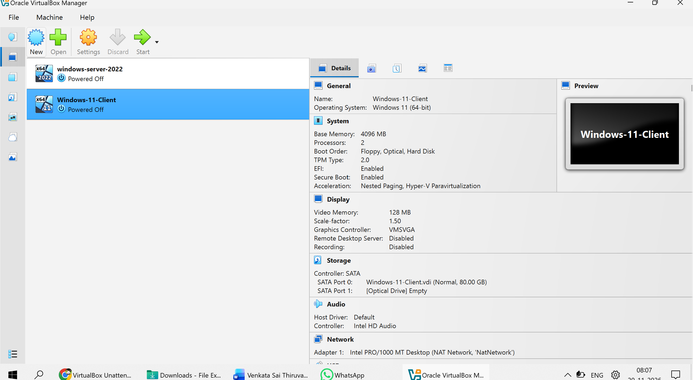

# OnPremises-ActiveDirectory-to-EntraID-Hybrid-Lab

End-to-end On-Premises Active Directory (Windows Server 2022) and Microsoft Entra ID Hybrid Cloud Security Lab

## The Story

Imagine a company called **CorpLab** running its entire user and device management on an on-premises Windows Server. Every user, every department, every password, and every workstation policy — all managed locally on a single Domain Controller (`corp.local`).

The IT team decided it was time to **modernize and extend to the cloud**. The goal: synchronize on-premises Active Directory identities to **Microsoft Entra ID** (`CorpLab-Entra`) — Microsoft's modern cloud identity platform — enforce zero-trust privileged access, and automate cloud device management with **Microsoft Intune** without disrupting end users.

---

## Tech Stack

| Layer | Technology | Purpose |
| :--- | :--- | :--- |
| **Virtualization** | Oracle VirtualBox | Isolated enterprise lab host environment |
| **On-Premises Server** | Windows Server 2022 | Domain Controller (`corp.local`), AD DS, DNS, and GPOs |
| **Client Workstation** | Windows 11 Enterprise | Domain-joined corporate endpoint |
| **Hybrid Sync Engine** | Microsoft Entra Connect | Synchronizes AD users, groups, and password hashes |
| **Cloud Identity** | Microsoft Entra ID (P2) | Cloud directory (`CorpLab-Entra`), PIM, and ID Protection |
| **Endpoint Management** | Microsoft Intune | Automated MDM device enrollment and compliance |
| **Automation & Audit** | PowerShell | Hybrid join verification (`dsregcmd`) and policy updates |

---

## Phase 1 — Building the Foundation

### Step 1: Virtual Environment Provisioning
* **Hypervisor Setup:** Installed and configured **Oracle VirtualBox** on the physical host machine to simulate an isolated enterprise data center.
* **Virtual Network Architecture:** Configured a dedicated virtual network segment (`NatNetwork`) so the Domain Controller and corporate workstation could communicate privately while maintaining controlled internet access for cloud synchronization.
* **Virtual Machine Provisioning:** Built and allocated dedicated compute, memory, and storage resources for two core enterprise nodes:
  * **`windows-server-2022` (`Windows Server 2022`):** Primary Domain Controller and DNS server (2 vCPUs, 4 GB RAM, dynamically allocated VDI storage).
  * **`Windows-11-Client` (`Windows 11 Enterprise`):** Corporate endpoint workstation used for domain join, Group Policy testing, and Intune enrollment (2 vCPUs, 4 GB RAM, dynamically allocated VDI storage).

*Oracle VirtualBox Manager showing the provisioned Windows Server 2022 Domain Controller (`windows-server-2022`) and Windows 11 Enterprise client (`Windows-11-Client`) VMs on NatNetwork.*

### Step 2: Static Networking & DNS Configuration
* **Domain Controller Static IP:** Assigned a static IPv4 address (`192.168.10.10/24`) to **`windows-server-2022`** so client machines and DNS records always resolve to a consistent server endpoint.
* **Local DNS Loopback:** Configured **`windows-server-2022`**'s preferred DNS server to point to its own static IP / loopback (`127.0.0.1`) in preparation for hosting the Active Directory-integrated DNS zone.
* **Client DNS Pointing:** Configured **`Windows-11-Client`**'s IPv4 network adapter to use **`windows-server-2022`** (`192.168.10.10`) as its primary DNS server, ensuring all internal domain queries route directly to the Domain Controller.
* **Connectivity Verification:** Validated bidirectional network reachability and name resolution between **`Windows-11-Client`** and **`windows-server-2022`** using `ping` and `nslookup` before promoting the server.

> **Why this matters:** Active Directory relies heavily on DNS (`SRV` records) for Domain Controller discovery, Kerberos authentication, and Group Policy retrieval. Pointing clients to an external public DNS instead of the internal Domain Controller is the #1 cause of failed domain joins in enterprise environments.

---

## Phase 2 — Setting Up Active Directory (`corp.local`)

### Step 1: Installing AD DS & Promoting the Domain Controller
* **Role Installation:** Installed the **Active Directory Domain Services (AD DS)** and **DNS Server** roles on the **Windows Server 2022** (`windows-server-2022`) virtual machine via Server Manager.
* **Domain Promotion:** Promoted the server to a primary Domain Controller, creating a new forest and root domain named **`corp.local`** (NetBIOS: `CORP`) with **Global Catalog (GC)** enabled and a DSRM recovery password configured.
* **Post-Reboot Validation:** Rebooted the Domain Controller and verified that core directory services (`NTDS`, `DNS`, `Netlogon`, `KDC`) were running and Active Directory DNS zones (`_msdcs.corp.local` and `corp.local`) were populated.
